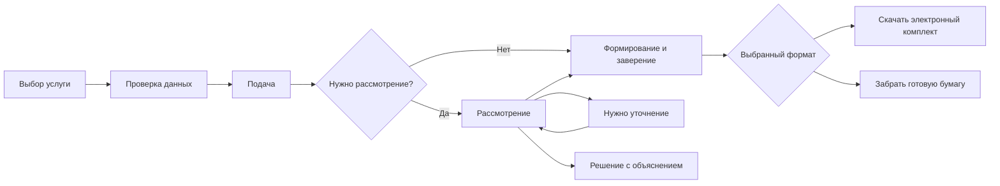

# Направление для обсуждения: справочный стол внутри учебной жизни

Это гипотеза будущего сервиса, а не утверждённое техническое задание. Основание — [наблюдения в кабинетах](01-observations.md) и [сравнение сервисов](02-benchmarks.md). Реальные потребности и ограничения филиала ещё предстоит проверить.

Визуальное направление уточнено пользователем: за основной референс берём ЕЛК ВШЭ. Структура форм, истории заявок и измеренные параметры оформления собраны в [подробном разборе](05-hse-workflow-and-design.md). Это основа следующего этапа проектирования, а не уже созданный интерфейс.

## Задача студента

«Мне нужен подходящий документ. Хочу понять, что выбрать, получить его вовремя и не искать ответ по разным отделам».

Для проверки этой задачи предлагаем начинать с цифрового справочного стола. Он должен объяснять результат и вести до его получения. Главный эффект, который предстоит измерить, — меньше неопределённости, повторного ввода и лишних посещений.

## Кандидаты для первого каталога

После уточнения пользователя U01 фиксируем пять видимых услуг ВШЭ как исходные кандидаты для обсуждения применительно к филиалу МГИМО:

1. Справка о подтверждении факта обучения на русском языке.
2. Справка о подтверждении обучения на английском языке.
3. Выписка из электронной зачётной книжки на русском языке.
4. Выписка на английском языке — Transcript.
5. Справка об уровне владения английским языком.

Общий сценарий заказа может обслуживать три семейства документов: подтверждение обучения, выписку и языковую справку. Язык, формат и дополнительные параметры задаются там, где они доступны. Состав кандидатов не означает, что все пять услуг уже согласованы с МГИМО или одинаково часто нужны студентам.

## Подача, обработка и получение

**Стандартная подача всегда онлайн.** Студент выбирает вид документа и доступный формат результата; определение ответственного подразделения выполняет сервис.

| Формат получения | Предлагаемый путь после онлайн-запроса |
|---|---|
| Электронный документ | Уведомление о готовности → скачивание документа и необходимых файлов подписи в кабинете; посещение не требуется. |
| Бумажный документ | Изготовление → уведомление о готовности с местом и часами выдачи → один визит за результатом. При необходимости доступна запись. |

Способ обработки — отдельная характеристика услуги:

| Обработка | Предлагаемое поведение |
|---|---|
| Стандартный документ по проверенным данным | Формирование по утверждённому шаблону и предусмотренное заверение; автоматизация возможна в пределах согласованного процесса. |
| Заявление или документ с рассмотрением | Проверка сотрудником, исполнитель, срок, уточнения и результат в той же заявке. |

Электронный документ может требовать работы сотрудника; слово «онлайн» само по себе не означает мгновенную автоматическую выдачу. Для обоих форматов студент видит статус в одном месте. Особые услуги с обязательным личным присутствием описываются отдельно после проверки правил филиала.

Пользовательский опыт ВШЭ задаёт желаемую модель взаимодействия. Регламенты, ответственные подразделения, доступные языки и способы заверения для МГИМО ещё требуют проверки.

## Путь стандартной справки

1. На главной студент выбирает «Получить справку» либо вводит цель: «для работы», «для стажировки», «подтвердить обучение».
2. Кабинет предлагает подходящие варианты с коротким объяснением. Полный каталог остаётся доступен.
3. В карточке услуги видны состав документа, доступные языки и форматы, срок и необходимость визита.
4. Сведения из профиля показаны одним компактным блоком. Студент проверяет их, а не заполняет заново пять списков. Ошибка в данных ведёт к отдельному понятному исправлению.
5. Студент выбирает только недостающие параметры. Перед подачей видит краткое резюме.
6. После подачи получает номер, ожидаемую дату и следующий шаг. Заявка доступна с главной и из истории.
7. Электронный результат скачивается целиком. Если формат использует отдельную подпись, основное действие сохраняет документ вместе с подписью и пояснением. Отдельные файлы тоже доступны. Для бумажного результата вместо скачивания показываются готовность, место и часы выдачи: заявка уже подана онлайн, остаётся получить изготовленный документ.

Для автоматического и ручного пути нельзя показывать одинаковую фиктивную историю работы. История должна отражать реальные события.

## Как связать обязательное ядро

| Раздел | Предлагаемый смысл | Связь со справочным столом |
|---|---|---|
| Главная | Ближайшее занятие, важное изменение, личный срок, активные заявки | Видно, нужна ли реакция и где уже готов результат. |
| Расписание | Сегодня и неделя; личная языковая подгруппа; аудитория, преподаватель, онлайн-ссылка | Из изменения ведём к конкретному занятию; из вопроса о расписании — к обращению с уже выбранным предметом. |
| Успеваемость | Результаты по дисциплинам, понятное объяснение показателей, ближайшие формы контроля | Из дисциплины можно запросить выписку или задать предметный вопрос. Пустое состояние объясняет, что известно и когда ждать данные. |
| Справки и заявления | Каталог по задачам, черновик, подача, история, результат | Основной сквозной сценарий будущего прототипа. |
| Уведомления | Только относящиеся к студенту события с действием и сроком | «Нужно уточнить данные» ведёт в ту же заявку. Общие новости остаются отдельным потоком. |
| Профиль | Проверенные сведения об обучении и настройка подгрупп | Данные повторно используются в формах. Исправление официальных сведений имеет свой процесс. |

Главную предлагаем проверять в двух вариантах: «личные действия первыми» и «расписание первым». Выбор ещё не сделан. Общие новости, рейтинг и витрина сервисов не должны автоматически занимать главное место только потому, что так устроены существующие системы.

## Самостоятельные идеи с обоснованием

**Личное расписание с языковыми подгруппами.** Для каждой дисциплины студент должен понимать, какое занятие относится к нему. При отсутствии подтверждённой подгруппы кабинет просит выбрать её и показывает, откуда взяты сведения. Это гипотеза по наблюдению M05; автоматическая интеграция пока не исследована.

**Помощь по цели.** Вместо требования знать название подразделения — несколько понятных вопросов и ссылка на основание рекомендации. Такой помощник может работать и без генеративного ИИ; его полезность не зависит от чатового интерфейса.

**Объяснение ожидания.** Помимо статуса — что происходит, до какого срока, от кого нужен следующий шаг. Если срок ещё нельзя вычислить, кабинет честно показывает это вместо выдуманной точной даты.

**Повторное обращение по тому же вопросу.** Исправление документа или уточнение связывается с исходной заявкой. Не надо заново описывать всю ситуацию. Правила возврата закрытого обращения согласуются с сотрудниками.

**Актуальность данных.** Главная карточка и полный раздел используют согласованные сведения. При задержке обновления видны дата и состояние загрузки. Последнее успешно загруженное расписание отличимо от свежего.

## Адаптация под филиал

Общие сценарии остаются едиными, а филиал задаёт каталог доступных услуг, ответственные подразделения, часы работы, сроки, шаблоны, языки, места выдачи и порядок записи. Сведения о филиале берутся из подтверждённого профиля обучения. Если у человека несколько оснований обучения, он выбирает контекст, который ему действительно доступен.

Для каждой услуги до реализации нужна карточка процесса:

- кто может обращаться и какой результат получает;
- откуда берутся сведения и как исправить ошибку;
- какие параметры и документы обязательны;
- требуется ли рассмотрение, заверение или визит;
- кто отвечает за результат и уточнения;
- какой срок установлен и как он считается;
- какие события меняют статус и запускают уведомление.

## Роль ИИ в будущем продукте

Возможные задачи: помочь найти услугу, объяснить опубликованное правило простым языком, предложить черновик обращения и проверить заполненность формы. Ответ должен ссылаться на проверяемую информацию и дату её актуальности.

Официальные сведения, оценки, решение о предоставлении услуги и подпись документа не следует отдавать на свободное усмотрение языковой модели. Подача остаётся явным действием студента. Сбой ИИ не должен мешать открыть расписание, оценки или подать обычную форму.

Пока не решено, нужен ли генеративный ИИ внутри самого прототипа. Использование ИИ при создании продукта и наличие чат-бота в интерфейсе — разные решения.

## Проверка до программирования

Предлагаем 6–8 коротких бесед со студентами разных курсов выбранного филиала и 1–2 беседы с сотрудниками, принимающими обращения. Это план, не выполненное исследование.

Спросить о последнем реальном случае, а не о желании иметь «удобное приложение»:

1. Какой документ или решение понадобились и зачем?
2. С чего начался поиск? Кто подсказал нужное место?
3. Какие шаги пришлось выполнить, какие данные вводить повторно?
4. Сколько прошло времени и сколько раз пришлось уточнять статус?
5. Где оказалось сложнее всего? Что делалось с телефона?
6. Как получатель принял документ и не пришлось ли переделывать?
7. Какие действия в расписании и оценках приходится делать вручную?
8. Какие уведомления действительно требуют реакции?

Приоритеты уточнять по частоте, тяжести последствий, затраченному времени и возможности изменить процесс. Доступность интеграции обсуждать отдельно от ценности для студента.

## Будущие критерии проверки прототипа

Это цели для дальнейшего этапа, а не результаты текущей работы:

- Нужная услуга находится с главной максимум за два перехода; скорость заполнения формы измеряется отдельно.
- Основные сценарии проходят на настоящей ширине 360 px без потери действий и горизонтальной прокрутки всей страницы.
- Два вымышленных аккаунта имеют разные данные и заявки; прямой адрес чужого ресурса не даёт доступа.
- Пароли защищены при хранении, служебные секреты не попадают в браузер или исходники.
- Данные сохраняются после повторного входа; обновление страницы не создаёт дубликат заявки.
- Предусмотрены отсутствие оценок, отсутствие заявок, задержка загрузки, исправление данных, запрос уточнения, отказ с причиной и готовый результат.
- Демонстрационные документы явно обозначены как учебные. Настоящая подпись университета не имитируется.
- Отдельно проверены доступность из России, тестовые аккаунты, исходники и срок работы хостинга по условиям конкурса.

До проверки процессов филиала и выбора основных сценариев делать весь проект преждевременно.
